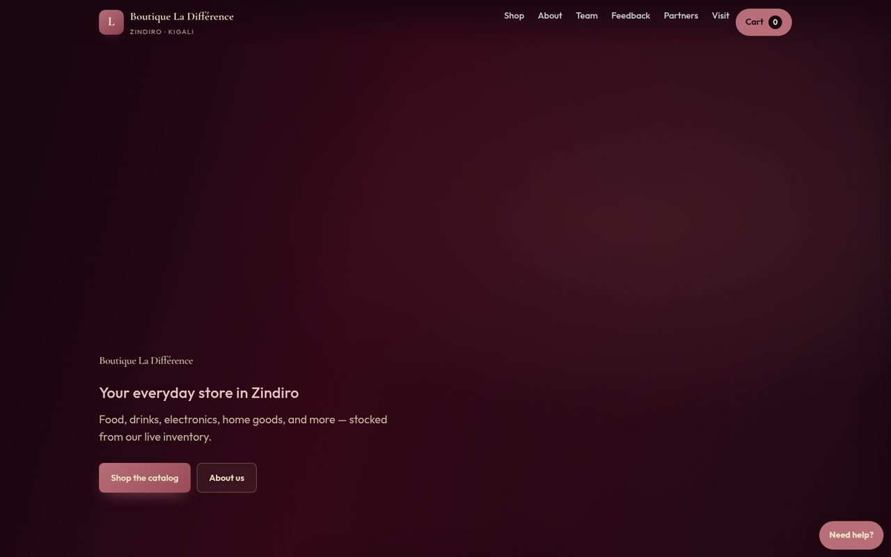
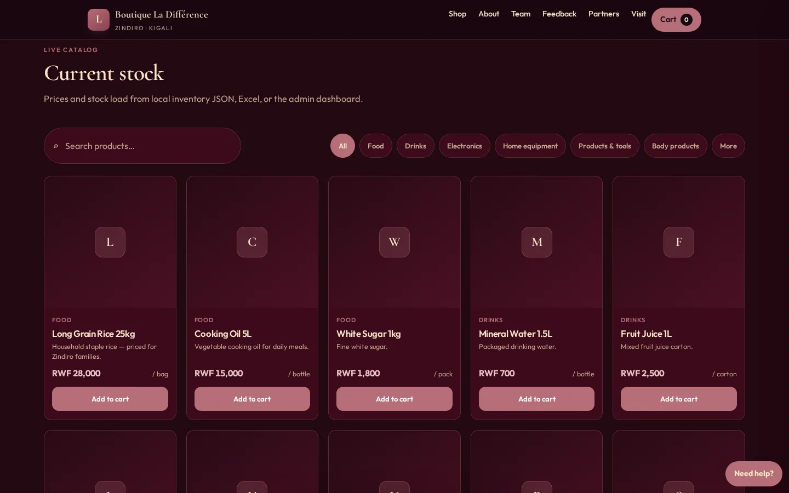
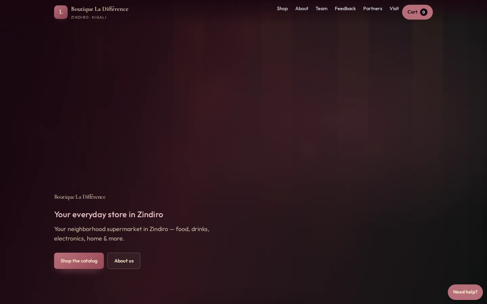
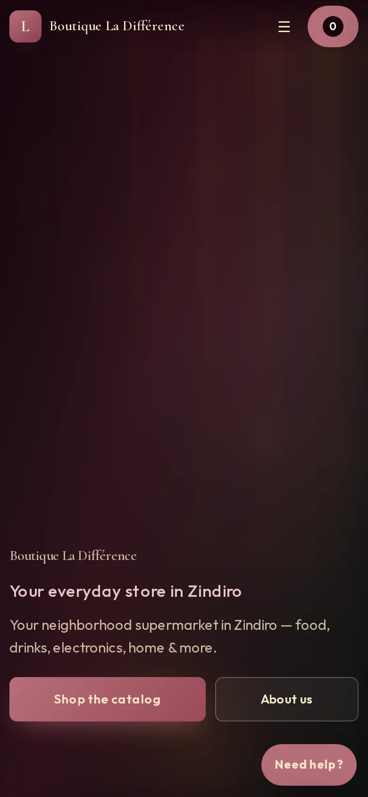

# Boutique La Différence

[](https://arnold-rg.github.io/Boutique-la-difference/)
[](https://arnold-rg.github.io/Boutique-la-difference/)
[](LICENSE)
[](https://developer.mozilla.org/en-US/docs/Web/HTML)
[](https://developer.mozilla.org/en-US/docs/Web/CSS)
[](https://developer.mozilla.org/en-US/docs/Web/JavaScript)

[](https://arnold-rg.github.io/Boutique-la-difference/)

Professional **neighborhood supermarket** storefront for **Boutique La Différence** (Zindiro, Kigali) — food, drinks, electronics, home equipment, tools, body products, and more.

This repository is the **public shop only**. It is a static GitHub Pages site. Customers do not sign in. The owner’s office (sign-in, stock tools, staff records) lives in a separate private repository, `Arnold-RG/boutique-la-difference-office`, and is not part of this tree or the Pages build.



| Home | Phone |
|---|---|
|  |  |

| Surface | URL |
|--------|-----|
| **Public shop** | [arnold-rg.github.io/Boutique-la-difference](https://arnold-rg.github.io/Boutique-la-difference/) |
| **Repository** | [github.com/Arnold-RG/Boutique-la-difference](https://github.com/Arnold-RG/Boutique-la-difference) |

---

## Highlights

### Public website (no customer login)
- Cinematic hero, category browsing, live product catalog
- **Shopping cart** + WhatsApp checkout (name, phone, delivery)
- About us, our team, partner / Rwanda business ads
- Events & discounts, gallery, map & hours
- Social links + customer service chat widget

Catalog **names, prices, and photos are not hard-coded** — they come from [`data/products.json`](data/products.json), from Excel / CSV / Sheets, or from a JSON backup restored in the private office.

---

## Programming tools & technologies

Everything used to design, build, and host the public shop:

| Tool / technology | Role in this project |
|-------------------|----------------------|
| **HTML5** | Semantic storefront structure |
| **CSS3** | Wine / champagne / rose-gold design system, layout, responsive UI, motion |
| **JavaScript (ES2020+)** | App logic, cart, catalog render |
| **CSV + Google Sheets export** | Spreadsheet sync without a custom backend on the shop |
| **localStorage / IndexedDB** | Catalog vault and cart on this origin (GitHub Pages has no server DB) |
| **Canvas 2D** | Cinematic hero atmosphere when no video URL is set |
| **Google Fonts** | [Cormorant Garamond](https://fonts.google.com/specimen/Cormorant+Garamond) + [Outfit](https://fonts.google.com/specimen/Outfit) |
| **Git** | Version control |
| **GitHub** | Source hosting & collaboration |
| **GitHub Pages** | Free worldwide HTTPS hosting |
| **Microsoft Excel / Google Sheets** | Inventory master data for the shop |
| **WhatsApp deep links** | Order handoff from the cart |

No Node/npm build step is required to run the live site — open the HTML files or use GitHub Pages.

---

## Project structure

```
Boutique-la-difference/
├── index.html                 # Public storefront
├── assets/
│   ├── css/
│   │   └── site.css           # Public shop
│   └── js/
│       ├── data.js            # Catalog store · Excel/CSV/Sheets
│       └── store.js           # Public UI · cart · chat
├── data/
│   ├── products.json          # Catalog seed
│   ├── catalog.template.csv   # Inventory column template
│   └── README.md              # How to update the catalog
├── LICENSE                    # MIT
└── README.md
```

The `admin/` folder, office scripts, password hash, and sign-in server are not in this repository.

---

## Quick start

### Online
Open the [live shop](https://arnold-rg.github.io/Boutique-la-difference/). Customers do not sign in.

### Local
1. Clone the repo:
   ```bash
   git clone https://github.com/Arnold-RG/Boutique-la-difference.git
   cd Boutique-la-difference
   ```
2. Open `index.html` in a browser, or serve the folder with any static file server.

---

## Excel & Google Sheets

Template: [`data/catalog.template.csv`](data/catalog.template.csv)

| Column | Notes |
|--------|--------|
| `name` | Required |
| `category` | `food` · `drinks` · `electronics` · `home` · `tools` · `body` · `more` |
| `price` / `cost` | Sell & cost amounts |
| `barcode` / `sku` | Scan & lookup |
| `unit` / `stock` | Unit label & quantity |
| `image` | URL or attach from the private office |
| `featured` / `active` | `true` / `false` |

The public catalog seed is [`data/products.json`](data/products.json). To change what every visitor sees, edit that file in this repository (or open a pull request). Spreadsheet sync and full JSON backup are tools in the private office, not on this public site.

**Backup of an old in-browser office:** the previous public admin page stored stock, orders, and notes in that browser. Before that page is retired, open it once and download a JSON backup. A new office address starts empty until that file is restored there. The public shop on GitHub Pages and a hosted office are different origins, so they do not share `localStorage`.

## Publishing the shop

The live shop is [https://arnold-rg.github.io/Boutique-la-difference/](https://arnold-rg.github.io/Boutique-la-difference/).

`.github/workflows/pages.yml` publishes the public files to GitHub Pages on every push to `main`. In the repository, open **Settings → Pages → Build and deployment** and set **Source** to **GitHub Actions**.

If Pages is still set to deploy from the branch, `_config.yml` leaves out any leftover office or server paths. Switch the source to GitHub Actions when you can, so the workflow is what goes live.

## Security

See [SECURITY.md](SECURITY.md) for disclosure policy.

- The shop has no customer account and no owner login.
- This repository does not contain an admin password, password hash, TOTP seed, or session secret.
- Product names/descriptions escaped before HTML render; external links use `noopener noreferrer`.
- Cart: IndexedDB preferred with localStorage mirror; catalog seed from [`data/products.json`](data/products.json).

## Design

- Ivory paper, deep forest, and a champagne-gold rule
- Typography: **Cormorant Garamond** for titles, **Outfit** for the interface
- Layout for phones, tablets, laptops, wide monitors, and large screens  

---

## Author

**Arnold Rurangwa** · Computer Engineer  

Repository: [Arnold-RG/Boutique-la-difference](https://github.com/Arnold-RG/Boutique-la-difference)

---

## License

MIT — see [LICENSE](LICENSE).
